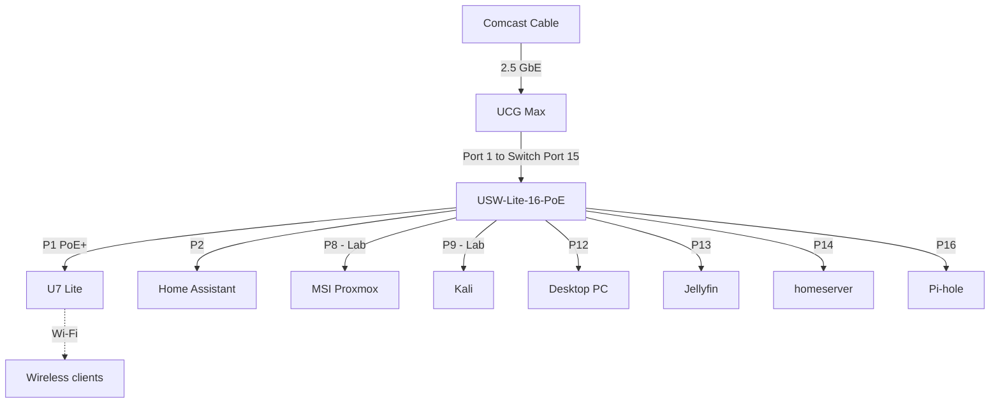

# Home Network

UniFi-based home network with segmented VLANs for trusted devices, IoT, and a homelab.

> **Sanitized for publishing:** WAN IP, MAC addresses, SSIDs and credentials are intentionally omitted.

## Hardware

| Device | Role | Notes |
|---|---|---|
| Comcast cable modem | ISP | Connected to UCG Max WAN at 2.5 GbE |
| UniFi Cloud Gateway Max (UCG Max) | Router / firewall / DHCP | Gateway for all VLANs |
| USW-Lite-16-PoE | Core switch | 192.168.50.216, uplinked to UCG Max port 1 |
| U7 Lite | Wi-Fi access point | PoE+ from switch port 1, 192.168.50.118 |
| Raspberry Pi | Pi-hole DNS | 192.168.50.5 |
| Home Assistant | Home automation | 192.168.50.2 |
| MSI (Proxmox) | Hypervisor | Lab VLAN, 192.168.100.186 |
| Jellyfin host | Media server | 192.168.50.162:8096. Rebuild to bare-metal Ubuntu planned |

## Topology

## Networks

| Name | VLAN | Subnet | Gateway | DHCP | Isolated | Purpose |
|---|---|---|---|---|---|---|
| Default | 1 | 192.168.50.0/24 | 192.168.50.1 | UCG Max | No | Trusted devices, core services |
| IoT | 2 | 192.168.20.0/29 | 192.168.20.1 | UCG Max (.2 to .6) | Yes | TV, game console, smart devices |
| Lab | 100 | 192.168.100.0/24 | 192.168.100.1 | UCG Max | Yes | Proxmox, security tools |

**IoT network settings**
- Isolate Network: on. Allow Internet Access: on.
- Auto-Scale Network: on. The /29 only has 5 usable leases, so it relies on auto-scale to grow if it fills.
- DHCP Guarding: on (trusted server: 192.168.20.1).
- DNS: manual (not auto). Clients use Pi-hole (192.168.50.5).

IPv6 is not configured on any network.

## Switch Port Map (USW-Lite-16-PoE)

| Port | Device | Native VLAN | PoE | Speed |
|---|---|---|---|---|
| 1 | U7 Lite (AP) | Default | PoE+ | GbE |
| 2 | Home Assistant | Default | Off | GbE |
| 3 to 7 | *Unused* | Default | PoE+ | n/a |
| 8 | MSI Proxmox | **Lab** | Off | GbE |
| 9 | Kali | **Lab** | n/a | GbE |
| 10 to 11 | *Unused* | Default | n/a | n/a |
| 12 | Desktop PC | Default | n/a | GbE |
| 13 | Jellyfin | Default | n/a | GbE |
| 14 | homeserver | Default | n/a | n/a |
| 15 | Uplink to UCG Max | Default | n/a | GbE |
| 16 | Pi-hole (Raspberry Pi) | Default | n/a | GbE |

## Wireless

All Wi-Fi clients connect through the U7 Lite. Devices are placed on IoT with UniFi's **Virtual Network Override** (per-client setting), not a separate SSID.

| Device type | Network |
|---|---|
| Roku TV | IoT (override) |
| Nintendo Switch 2 | IoT (override) |
| Phones, laptops, tablets | Default |
| DD-WRT router (wireless client) | Default |

## Firewall Rules (Zone-Based, Internal to Internal)

IoT and Lab are isolated, so these rules allow only the cross-VLAN traffic that is needed.

| ID | Name | Action | Source | Destination | Port | Purpose |
|---|---|---|---|---|---|---|
| 10001 | IoT to Pihole | Allow | IoT network | 192.168.50.5 | 53 | IoT devices use Pi-hole for DNS |
| 10000 | Tv to Jelly | Allow | Roku TV (device) | 192.168.50.162 | 8096 | Roku streams from Jellyfin |
| 10002 | Main to lab | Allow | Desktop PC (device) | Lab network | Any | Manage Proxmox/lab from main PC only |

## Services

| Service | Host | Address | Notes |
|---|---|---|---|
| DNS / ad blocking | Pi-hole (Raspberry Pi) | 192.168.50.5 | Must permit queries from non-local subnets (IoT) |
| Home automation | Home Assistant | 192.168.50.2 | |
| Media | Jellyfin | 192.168.50.162:8096 | Firewall rule depends on this IP |
| Virtualization | Proxmox (MSI) | 192.168.100.186 | Lab VLAN |
| Security testing | Kali | 192.168.100.55 | Lab VLAN |

## Known Limitations

- **Casting to the Roku from Default devices** likely won't work. IoT is isolated, and discovery needs Default-to-IoT traffic plus mDNS/SSDP.
- **Home Assistant** is on Default. Any smart devices moved to IoT will need firewall rules (and possibly mDNS) for HA to reach them.
- **Firewall hit counters reset on gateway reboot**, so zero hits after a power outage doesn't mean a rule is broken.

## TODO

- [ ] Rebuild Jellyfin host as bare-metal Ubuntu, then add a DHCP reservation (or static IP) so `Tv to Jelly` keeps working. The MAC will change from the Proxmox VM MAC.
- [ ] Move Jellyfin to Docker Compose and version the compose file in this repo.
- [ ] Add DHCP reservations for other services (Pi-hole, Home Assistant, Proxmox).
- [ ] Narrow `IoT to Pihole` protocol from All to TCP/UDP.
- [ ] Document the purpose of the DD-WRT router and what connects behind it.
- [ ] Document SSIDs and their network assignments (names kept private).
